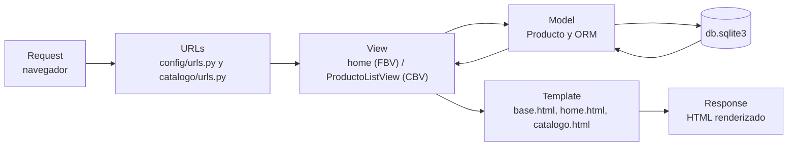
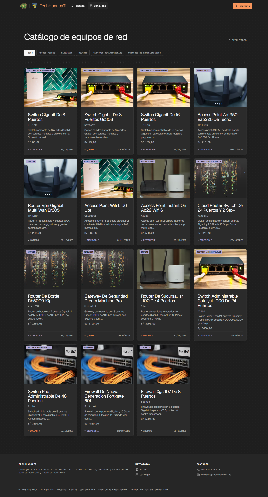
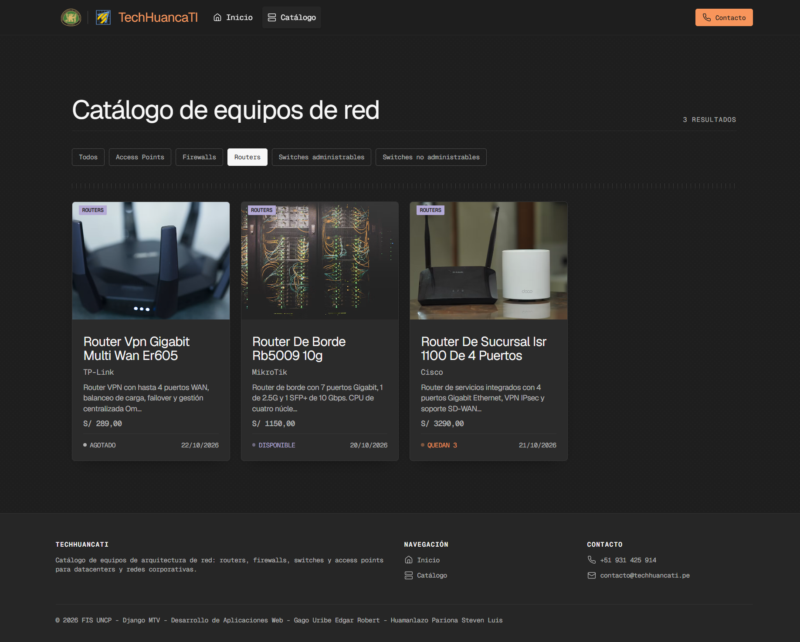
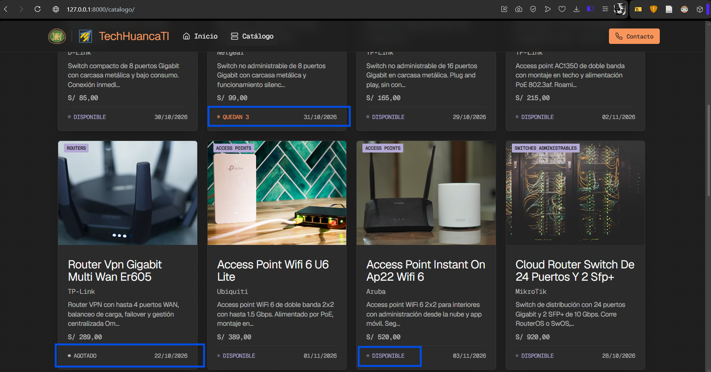
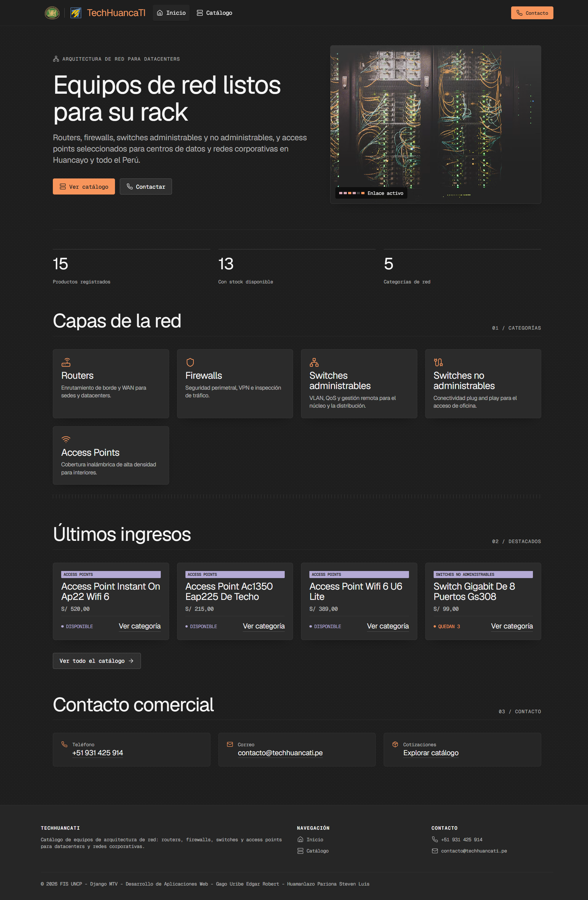
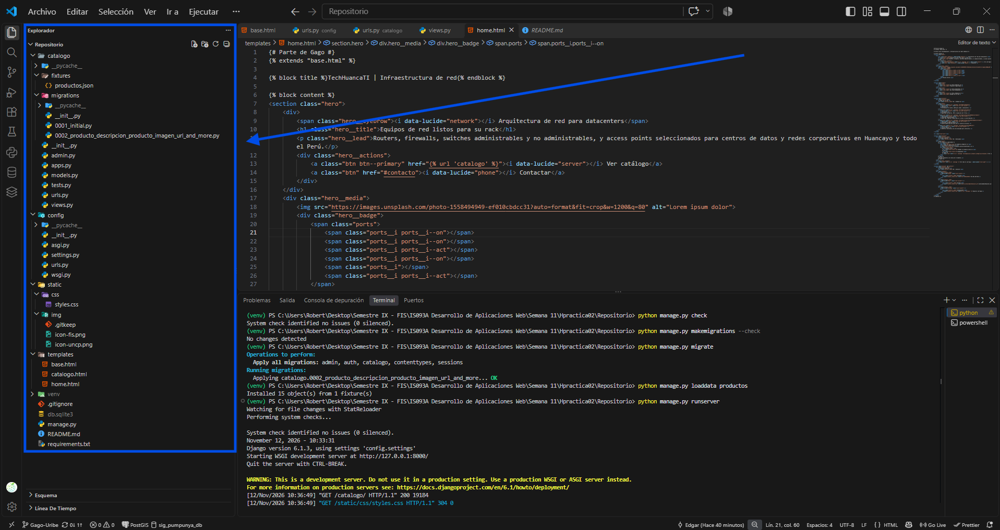
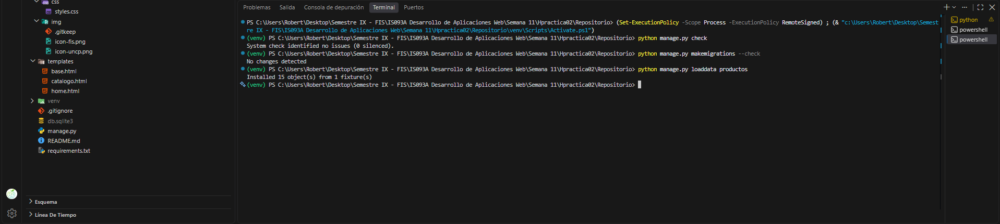
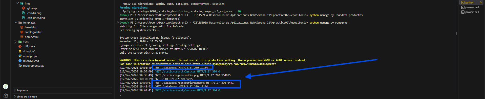

# TechHuancaTI

Catálogo de productos de arquitectura de red (routers, firewalls, switches administrables y no administrables, access points) desarrollado con Django para la asignatura Desarrollo de Aplicaciones Web (IS093A), Guía Práctica Grupal Semana 11, Facultad de Ingeniería de Sistemas, Universidad Nacional del Centro del Perú.

## Integrantes

| Integrante | Rol técnico |
|---|---|
| Gago Uribe Edgar Robert | Arquitecto Django y Desarrollador de Vistas |
| Huamanlazo Pariona Steven Luis | Ingeniero de Plantillas y QA & ORM Validator |

## Arquitectura MTV

Django separa la aplicación en Model (datos y ORM), Template (presentación) y View (lógica). El flujo de una petición es el siguiente:



Rutas del proyecto:

| Ruta | Vista | Nombre |
|---|---|---|
| `/` | `home` (FBV) | `home` |
| `/catalogo/` | `ProductoListView` (CBV, ListView) | `catalogo` |
| `/catalogo/?categoria=Routers` | `ProductoListView` filtrada por categoría | `catalogo` |

## QuerySets utilizados

### 1. `Producto.objects.filter(stock__gt=0)`

Se usa en la vista `home` (FBV). Devuelve solo los productos con stock mayor a cero y se guarda en la variable `disponibles`, que se reutiliza para listar los 4 últimos ingresos con `.order_by('-creado_en')[:4]` y para contar los productos disponibles con `.count()`.

### 2. `Producto.objects.order_by('precio')`

Se usa en `ProductoListView` (CBV). Ordena el catálogo de menor a mayor precio. Cuando la URL trae `?categoria=...`, se encadena `.filter(categoria=...)` sobre el mismo QuerySet. Esta consulta incluye los productos con stock 0, que la plantilla marca como Agotado.

### Lazy evaluation

Un QuerySet es perezoso: crearlo o encadenar métodos como `filter` y `order_by` no consulta la base de datos. La consulta SQL se ejecuta solo cuando el QuerySet se evalúa, por ejemplo al iterarlo con `for`, al convertirlo con `list()`, al usar `len()`, al hacer slicing con paso, o al llamar a `count()` y `exists()`.

En la vista `home`, `disponibles` no ejecuta ninguna consulta al definirse. Luego se reutiliza en dos operaciones distintas: `.order_by('-creado_en')[:4]` genera una consulta con `LIMIT 4` cuando la plantilla itera `destacados`, y `.count()` genera otra consulta `SELECT COUNT(*)`. Cada uso produce su propia consulta SQL al evaluarse.

## Capturas

Las capturas se tomaron con el proyecto corriendo en local (`python manage.py runserver`) y los 15 productos del fixture cargados.

### Catálogo renderizado

Vista `/catalogo/` (CBV `ProductoListView`) con los 15 productos ordenados por precio, barra de filtros por categoría, tarjetas con imagen, marca, descripción truncada, precio y estado de stock.



### Catálogo filtrado por categoría

Vista `/catalogo/?categoria=Routers`. El chip "Routers" queda activo y el QuerySet devuelve solo los 3 routers.



### Estados de stock

La plantilla usa ``, `` y `` sobre el campo `stock` para mostrar Agotado, Quedan N o Disponible.



### Página de bienvenida

Vista `/` (FBV `home`) con estadísticas calculadas desde la base de datos, categorías y los últimos ingresos con stock.



### Estructura de carpetas

Estructura MTV del proyecto: `config/`, `catalogo/` (con `fixtures/` y `migrations/`), `templates/` y `static/`.



### Validación técnica

Resultado de `python manage.py check` (sin errores), `makemigrations --check` (sin cambios pendientes) y `loaddata productos` (15 objetos instalados).



### Servidor sin errores 404 ni 500

Registro de `runserver` con respuestas `200` para `/catalogo/`, `/` y `/catalogo/?categoria=Routers`.




## Estructura del proyecto

```
GuiaPracticaGrupalSemana11/
├── config/
│   ├── settings.py
│   └── urls.py
├── catalogo/
│   ├── fixtures/
│   │   └── productos.json
│   ├── migrations/
│   ├── admin.py
│   ├── models.py
│   ├── urls.py
│   └── views.py
├── templates/
│   ├── base.html
│   ├── home.html
│   └── catalogo.html
├── static/
│   ├── css/styles.css
│   └── img/
├── docs/
│   ├── catalogo.png
│   ├── catalogo-filtro.png
│   ├── estados-stock.png
│   ├── estructura.png
│   ├── home.png
│   ├── runserver-200.png
│   └── validacion.png
├── manage.py
├── requirements.txt
└── README.md

```

## Ejecución

```powershell
python -m venv venv
.\venv\Scripts\Activate.ps1
pip install -r requirements.txt
python manage.py migrate
python manage.py loaddata productos
python manage.py runserver
```

Luego abrir `http://127.0.0.1:8000/` para la página de bienvenida y `http://127.0.0.1:8000/catalogo/` para el catálogo. El panel de administración está en `/admin/` y requiere `python manage.py createsuperuser`.